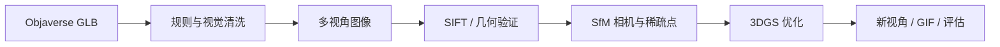

# 三维视觉课程项目：Objaverse 清洗、SfM 与 3DGS

已完成 **55,000 → 7,819** 资产筛选，以及 **10个物体的完整重建、10个GIF、全部匹配结果和流程对照实验**。

**第一组** · GitHub：[https://github.com/delta-dta/3D-Reconstruction-and-Rendering](https://github.com/delta-dta/3D-Reconstruction-and-Rendering)

**正式提交报告：[PDF](docs/HOMEWORK2_REPORT.pdf) · [Markdown 源文件](docs/HOMEWORK2_REPORT.md)**

[结果总览](index.html) · [Pipeline](docs/PIPELINE.md) · [对照实验](docs/EXPERIMENTS.md) · [复现](docs/REPRODUCE.md) · [提示词](docs/PROMPTS.md) · [提交说明](docs/SUBMISSION.md)

另有一个[重复纹理造成位姿歧义的实际案例](docs/MATCHING_CASE.md)，用于理解“特征多”和“对应可靠”的区别。

完整下载仓库（Code → Download ZIP）或本机生成的 `dist/coursework_submission.zip` 后解压，用浏览器打开根目录 `index.html`，保持 `results/` 与 `docs/` 的相对位置。单独下载 HTML 不包含图片资源。GitHub 可直接阅读 Markdown、PDF 并打开各 GIF。

## 运行pipeline

激活 `3dvision` 并在 `configs/pipeline.json` 中设置数据与工具位置后，从仓库根目录运行：

```bash
python -B programs/run_pipeline.py --config configs/hw2_lamb.json
```

统一入口依次完成成像、图像准备、SIFT/SfM、3DGS训练、评价/GIF和结果页面，新运行保存在 `outputs/pipeline/`。环境安装、十物体批处理和各阶段输出见 [PIPELINE](docs/PIPELINE.md)。六个阶段共用原实验的代码与参数。

只检查已提交材料可运行 `python -B programs/verify_repository.py`，不需要原始数据或GPU。

## 成员与分工

| 成员 | 分工 |
|---|---|
| 董天傲 | 数据来源与清洗结果整理、多视角图像生成与划分；负责24/48/96视角数量实验及数据部分文档。 |
| 黄瑞翔 | SIFT特征、匹配、SfM相机恢复与匹配结果导出；负责真实位姿对照、几何误差分析及重建部分文档。 |
| 陈泓逸 | 3DGS环境与训练配置、十物体优化及模型保存；负责7k/30k训练时长实验、训练曲线及优化部分文档。 |
| 郭文涛 | 新视角评价、GIF与结果页面、指标汇总；负责新高度实验、报告合并排版、仓库组织及复现说明。 |

成员分工见正式报告第1节。 AI 辅助范围见 [AI_USAGE](docs/AI_USAGE.md)。

## 主要结果

主实验：每物体 120 张 512² 参考图，96 张训练、24 张留出测试；SIFT / COLMAP 相机恢复与三角化，官方 3DGS 训练 30,000 次。全部 **960/960** 张训练相机注册成功。

10 物体等权平均：前景 PSNR **31.896 dB**，全图 PSNR **37.599 dB**，SSIM **0.98528**。

| 物体 | 前景 PSNR | 全图 PSNR | SSIM | 结果 |
|---|---|---|---|---|
| 贝壳标本 | 32.708 | 39.905 | 0.99271 | [GIF](results/hw2_shell/reconstruction.gif) · [详细结果](results/hw2_shell/index.html) |
| 食品罐头 | 32.143 | 36.441 | 0.99139 | [GIF](results/hw2_can/reconstruction.gif) · [详细结果](results/hw2_can/index.html) |
| 彩色跑鞋 | 32.187 | 38.016 | 0.99131 | [GIF](results/hw2_shoe/reconstruction.gif) · [详细结果](results/hw2_shoe/index.html) |
| 解剖教学模型 | 29.397 | 35.575 | 0.98317 | [GIF](results/hw2_brain/reconstruction.gif) · [详细结果](results/hw2_brain/index.html) |
| 石质渔具 | 38.047 | 43.505 | 0.99638 | [GIF](results/hw2_stone/reconstruction.gif) · [详细结果](results/hw2_stone/index.html) |
| 彩绘蜡烛 | 34.476 | 38.909 | 0.99153 | [GIF](results/hw2_candle/reconstruction.gif) · [详细结果](results/hw2_candle/index.html) |
| 装饰陶壶 | 18.923 | 25.864 | 0.93640 | [GIF](results/hw2_jug/reconstruction.gif) · [详细结果](results/hw2_jug/index.html) |
| 猫头鹰摆件 | 32.266 | 37.674 | 0.98645 | [GIF](results/hw2_owl/reconstruction.gif) · [详细结果](results/hw2_owl/index.html) |
| 机器人模型 | 30.866 | 36.292 | 0.98811 | [GIF](results/hw2_robot/reconstruction.gif) · [详细结果](results/hw2_robot/index.html) |
| 羊形陶质摆件 | 37.944 | 43.811 | 0.99538 | [GIF](results/hw2_lamb/reconstruction.gif) · [详细结果](results/hw2_lamb/index.html) |

每个结果页提供实际匹配图、全部几何验证内点、相机与稀疏点、24 个测试视角的对照及误差图。GIF 均由训练后的高斯模型生成。

## 流程与实验



- 图像数量：羊、罐头、机器人分别使用 24/48/96 个训练视角，固定测试集与迭代预算。
- 位姿：同三个对象比较 SfM 与真实训练外参，保持同一稀疏点初始化。
- 时长：全部 10 个对象比较 7k/30k 检查点。
- 视角覆盖：另渲染 0°/30°/60°各 12 个新视角，共 360 张独立测试图。

主流程使用标定内参，从训练图恢复外参；稀疏初始化来自图像三角化。训练相机中心只用于全局 Sim(3) 对齐，测试图像与外参不进入 SfM 或训练。全图指标包含白背景，因此同时报告前景 PSNR。

## 环境

```bash
conda env create -f environment.yml
conda activate 3dvision
```

RTX 5090；Python 3.12.3；PyTorch 2.8.0+cu129、torchvision 0.23.0+cu129；PyCOLMAP 3.13.0；Blender 4.5.3；CUDA 12.9、GCC 13.3、原生 sm_120 扩展。固定依赖在 `environment.yml`。

官方 3DGS 提交 `54c035f7834b564019656c3e3fcc3646292f727d`。环境安装、代码获取、`<cstdint>` 补丁和三个扩展的安装步骤见 [PIPELINE](docs/PIPELINE.md)。各子模块提交记录在 `results/hw2_*/environment.json`。

## 代码与结果

```text
programs/          清洗、渲染、SfM、训练、评价与报告程序
configs/           筛选规则、完整提示词、对象、实验参数
scripts/           无参数启动脚本；已完成命令以注释保留
patches/           CUDA 12.9 标准头文件补丁
docs/              报告、实验、复现、提示词与资产署名
results/           可提交的 GIF、匹配数组、对照图、指标与图表
outputs/           本机完整图像、数据库、模型与检查点（不入 Git）
cleaned/           本机全量清洗清单与预览（不入 Git）
.tools/            本机 Blender、官方 3DGS 和系统库（不入 Git）
```

清洗输入为 Objaverse v1.0 的 000-000～000-010，共 11 个分片。清洗清单保存在 `results/assignment1/`；数据根目录在 `configs/pipeline.json` 的 `dataset_root` 中设置。

作业 1 按 `run_coarse_filter` → `run_glb_filter` → `run_render_full` → `run_preview_deepseek` → `run_finalize_cleaning` 执行。作业 2 从 `configs/hw2_lamb.json` 和 `programs/render_hw2.py` 开始阅读，再依次看 prepare、reconstruct、train、evaluate。详细命令见[复现说明](docs/REPRODUCE.md)。

清洗使用 DeepSeek-V4.1-Flash-1017（接口调用名 `deepseek-flash`），实际提示词与请求参数见 [PROMPTS](docs/PROMPTS.md)。

资产来源和许可见 [ASSET_CREDITS](docs/ASSET_CREDITS.md)，第三方依赖见 [THIRD_PARTY](docs/THIRD_PARTY.md)，AI 辅助范围见 [AI_USAGE](docs/AI_USAGE.md)。
