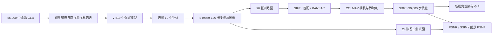
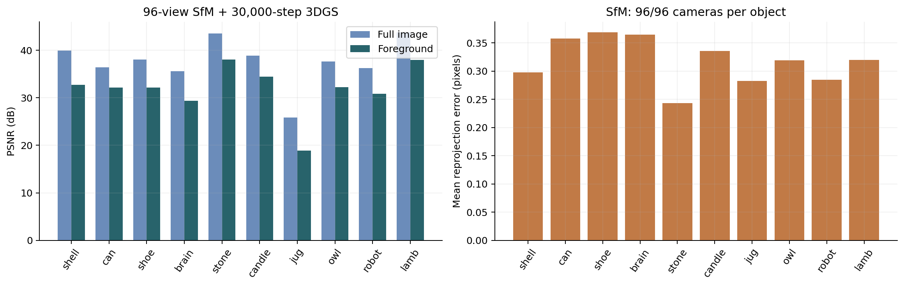
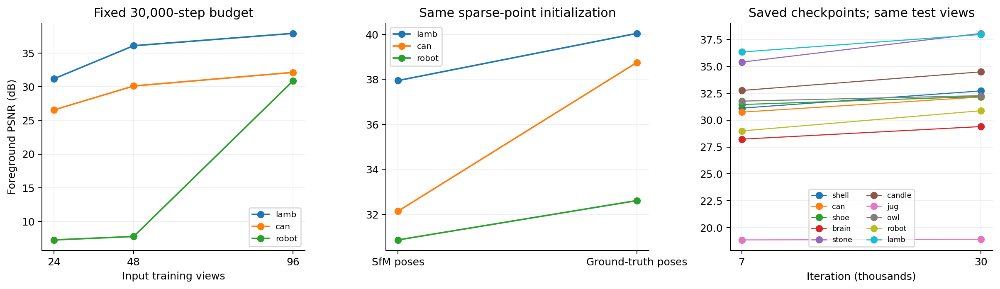

# 三维视觉课程项目：从 Objaverse 清洗到 3DGS 重建

组号：第一组  
GitHub：https://github.com/delta-dta/3D-Reconstruction-and-Rendering.git

- 成员1：数据来源与清洗结果整理、多视角图像生成与划分；负责24/48/96视角数量实验及数据部分文档。
- 成员2：SIFT特征、匹配、SfM相机恢复与匹配结果导出；负责真实位姿对照、几何误差分析及重建部分文档。
- 成员3：3DGS环境与训练配置、十物体优化及模型保存；负责7k/30k训练时长实验、训练曲线及优化部分文档。
- 成员4：新视角评价、GIF与结果页面、指标汇总；负责新高度实验、报告合并排版、仓库组织及复现说明。

成员1至成员4为指定代称；分工按相近工作量拟定，每人预计25%，提交前核对实际贡献。

正式提交报告：[Markdown](HOMEWORK2_REPORT.md) · [PDF](HOMEWORK2_REPORT.pdf)。本文保留课程全过程概览。

## 项目结果

完成 55,000 个 Objaverse 资产的清洗，保留 **7,819 个模型**。从中选取 10 个完整、表面细节充分且以不透明低反光材质为主的物体，分别完成图像生成、SIFT 匹配、SfM、3DGS 优化和新视角渲染。10 个对象均注册 96/96 张训练图，均提供完整匹配结果与 72 帧 GIF。

主实验的 10 物体平均前景 PSNR 为 **31.896 dB**，全图 PSNR 为 **37.599 dB**，SSIM 为 **0.98528**。此外完成 9 次对照训练、10 物体的两个检查点评估，以及 360 张新高度测试图评估。

## 1. 数据清洗与对象选择

源目录 `/mnt/aoss/datasets/Objaversev1.0/`；编号 000-000～000-010，共 11 个分片。依次进行元数据静态/面数/大小筛选，GLB 图元与材质筛选，四视角实际渲染，前景面积与 SIFT 筛选，DeepSeek 综合判别，以及 SHA-256 完全重复去重。

数量变化：**55,000 → 44,597 → 31,614 → 31,607 → 17,150 → 7,819**。

主要规则：500～1,000,000 三角面、≤100 MiB、独立静态物体、具有可用表面特征、主体不透明低反光。四张 256² 预览用于筛选，后续另行生成密集多视角训练图。原始 GLB 未移动，保留清单记录源路径和 SHA。

完整方法、阈值和各阶段输出见 [作业 1 报告](ASSIGNMENT1.md)。[提示词](PROMPTS.md)与[资产来源](ASSET_CREDITS.md)分别保留原文和署名信息。

正式对象验证中，编织器物的周期纹理造成明显位姿歧义，故从相同清洗结果中选择彩色跑鞋替换。该候选的输入、匹配和相机单独用于[匹配案例分析](MATCHING_CASE.md)，不进入正式 10 物体均值。

## 2. 图像 → 三维重建 → 新视角渲染

**受控成像。** 沿用作业 1 的归一化，将物体最长边缩放到 2 并居中。Blender 4.5.3、Cycles CUDA、512×512、64 samples、GPU OIDN、固定世界与三盏面积光，纹理分辨率上限 2048。相机焦距 50 mm、传感器宽 36 mm，三个高度 -20°/15°/45°，每圈 40 个方位，方位间隔 9°。

**训练/测试划分。** 每圈每五张留出一张，96 张训练、24 张测试。测试 RGB 与相机不会进入特征提取、SfM 或 3DGS 训练。训练图合成白色背景；alpha 生成前景和 SIFT 掩码。

**匹配与 SfM。** PyCOLMAP 3.13.0 CPU，前景内 SIFT，每图最多 4,096 个特征，比例阈值 0.8、交叉验证、两视图 RANSAC 误差阈值 2 px，穷举图像对。固定标定的 PINHOLE 内参，增量恢复训练外参并三角化稀疏点，束调整优化重投影误差。各物体保留四组代表匹配图、全部关键点和验证内点数组。

**坐标对齐。** 只用训练相机中心拟合 Sim(3)，同时变换恢复的点与相机，消除 SfM 的全局尺度、旋转和平移自由度。测试相机不参与对齐。真实外参未用于 SfM 初始化；初始点来自图像三角化。

**3DGS。** 使用官方实现，稀疏点初始化高斯，优化中心、旋转、尺度、不透明度和三阶球谐颜色。白色背景，损失 `0.8 L1 + 0.2 (1−SSIM)`；增密至 15,000 步，优化至 30,000 步；以保存的 7k/30k 高斯 PLY 比较阶段效果，保留最终恢复状态供后续训练。每个物体独立优化。

**评价。** 在留出相机上渲染，与 RGB 真值比较。逐视角计算全图 PSNR、SSIM、前景 PSNR（真实 alpha>0.5），再取算术平均。10 物体总均值对每个物体等权。GIF 在 15°高度环绕 72 帧，由高斯模型渲染；指标由浮点渲染结果计算，不使用 GIF 调色板图像计算。

## 3. 十个物体的主实验

| 物体 | 注册图 | 稀疏点 | 重投影 px | 前景 PSNR | 全图 PSNR | SSIM | 高斯数 |
|---|---|---|---|---|---|---|---|
| 贝壳标本 | 96/96 | 10237 | 0.297 | 32.708 | 39.905 | 0.99271 | 80944 |
| 食品罐头 | 96/96 | 7487 | 0.357 | 32.143 | 36.441 | 0.99139 | 211790 |
| 彩色跑鞋 | 96/96 | 4746 | 0.369 | 32.187 | 38.016 | 0.99131 | 105150 |
| 解剖教学模型 | 96/96 | 8995 | 0.364 | 29.397 | 35.575 | 0.98317 | 84515 |
| 石质渔具 | 96/96 | 13103 | 0.243 | 38.047 | 43.505 | 0.99638 | 120992 |
| 彩绘蜡烛 | 96/96 | 8562 | 0.336 | 34.476 | 38.909 | 0.99153 | 178410 |
| 装饰陶壶 | 96/96 | 9068 | 0.282 | 18.923 | 25.864 | 0.93640 | 179200 |
| 猫头鹰摆件 | 96/96 | 9242 | 0.319 | 32.266 | 37.674 | 0.98645 | 97462 |
| 机器人模型 | 96/96 | 10610 | 0.285 | 30.866 | 36.292 | 0.98811 | 153915 |
| 羊形陶质摆件 | 96/96 | 6977 | 0.320 | 37.944 | 43.811 | 0.99538 | 60362 |

全部 960 张训练相机注册成功，平均重投影误差为 **0.317 px**。输入、匹配、点云、逐视角对照与动画可从[课程总览](../index.html)进入各物体结果页。

不同物体的细节难度不同。陶壶整体和把手能够连续恢复，但误差图在细密环纹、磨损细节及轮廓附近较突出，前景指标也较低。该对象仍保留在主结果中，便于后续研究纹理对齐、相机误差与输入分辨率的影响；这些原因需要针对性对照进一步区分。

每个物体的主实验独立训练一次，固定随机种子。训练耗时记录包含加载与保存，逐次实测数值在 `results/metrics.csv`。部分主实验和独立对照在同一 GPU 上并行推进，因此墙钟耗时用于记录本次执行，不作为独占 GPU 的算法速度基准。运行环境为 RTX 5090、Python 3.12.3、PyTorch 2.8.0+cu129、CUDA 12.9；代码提交、参数和环境保存在结果中。

## 4. 流程中哪些环节影响结果？

**输入视角数量。** 在羊摆件、罐头、机器人上用相同图像池的 24/48/96 嵌套子集重新运行 SfM 和训练。保持测试集、迭代预算和其他设置一致，24→96 的平均前景 PSNR 变化为 **+11.981 dB**。变化来自观测覆盖、匹配约束及稀疏初始化的共同作用。

其中机器人 24 图条件注册了 24/24 个相机，24/48 图条件均发生明显几何退化；48 图的旋转误差中位数为 17.824°。这些条件使用最终返回重建中的相机训练，展示 SfM 失败如何传播至新视角渲染；输入数量与实际训练数量分列，正式 96 图基线正常注册全部相机并恢复正确环绕结构。

**相机位姿。** 同三个对象保持 96 张训练图和同一稀疏点初始化，只替换成真实训练相机外参。相对于 SfM 位姿，平均前景 PSNR 变化为 **+3.483 dB**。逐物体数据用于理解位姿误差如何影响纹理和轮廓。

**优化时长。** 所有 10 个物体比较 7k/30k 检查点，平均前景 PSNR 变化为 **+1.335 dB**。7k 仍在增密，30k 完成表示扩充与后续优化，因而同时体现时间与高斯容量的作用。

**视角覆盖与外推。** 另外生成 0°/30°/60°三圈、每圈 12 张新图，方位偏移 4.5°，共 360 张。0°和 30°处于训练高度之间；60°超出训练上界。三个高度的平均前景 PSNR 为 **29.438 / 30.785 / 29.835 dB**。新增测试帮助辨别附近视角插值与更大高度变化下的效果。

逐条件表格、控制变量与误差图见 [实验报告](EXPERIMENTS.md)。本项目的优化重点可据此定位到视角覆盖、相机恢复和高斯优化，而无需先扩大到全部 7,819 个物体。

## 5. 文件、复现与继续学习

`programs/` 保存计算程序，`configs/` 保存规则、物体与实验参数，`scripts/` 保存固定调用命令。`outputs/` 保留完整过程、图像、数据库、PLY 与检查点；`results/` 收集可提交结果、全部几何验证匹配、动画、指标与图表。

按 [复现说明](REPRODUCE.md) 执行，按 [学习指南](LEARNING_GUIDE.md) 追踪各阶段输入输出。全部视觉筛选提示词在 [PROMPTS.md](PROMPTS.md)，AI 编程辅助范围在 [AI_USAGE.md](AI_USAGE.md)。

参考：[Objaverse](https://arxiv.org/abs/2212.08051)、[COLMAP](https://colmap.github.io/tutorial.html)、[3D Gaussian Splatting](https://repo-sam.inria.fr/fungraph/3d-gaussian-splatting/)。
