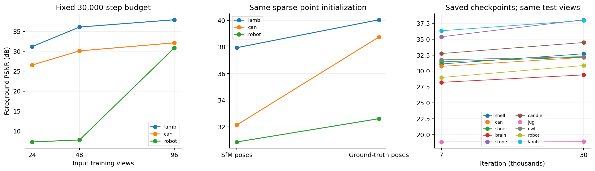
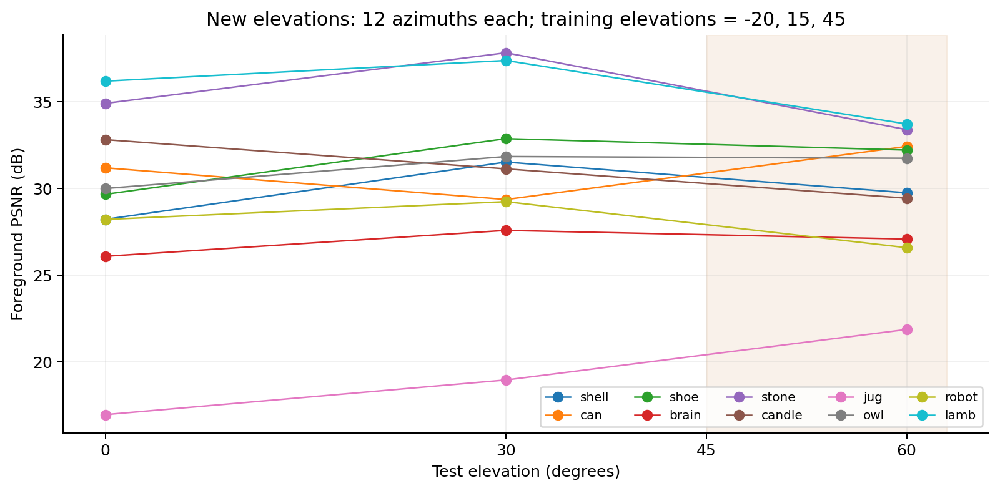

# 作业 2：对照实验与实际结果

图像子集、分辨率与训练预算在运行前写入 `configs/experiments/`。每个条件记录一次固定种子的正式训练结果；机器人 24 图条件在修正最终模型导出后重算，过程见复现说明。表中数值来自实际保存的评估文件。各物体内部使用同一测试集；比较时先取每视角指标，再取物体均值。

## 1. 图像数量与相机位姿

羊摆件、罐头和机器人使用 24⊂48⊂96 的嵌套训练子集，三个高度均匀覆盖。96 张原训练图按顺序每 4 张选 1 张得到 24 张，每 2 张选 1 张得到 48 张。所有条件使用相同的 24 张测试图、512 分辨率、30,000 次迭代和随机种子。每个子集重新提取特征、匹配和执行 SfM。

位姿对照只将 96 张训练图的相机外参替换为渲染器标定值，仍使用相同 COLMAP 稀疏点初始化，没有添加 GLB 表面点。`pose_control.json` 记录点坐标一致性。

| 物体 | 条件 | 输入训练图 | 注册图 | 实际训练图 | 初始稀疏点 | 前景 PSNR | 全图 PSNR | SSIM |
|---|---|---|---|---|---|---|---|---|
| lamb | 24 views | 24 | 24 | 24 | 1787 | 31.201 | 37.337 | 0.98114 |
| lamb | 48 views | 48 | 48 | 48 | 3831 | 36.110 | 42.081 | 0.99305 |
| lamb | 96 views / SfM | 96 | 96 | 96 | 6977 | 37.944 | 43.811 | 0.99538 |
| lamb | 96 views / GT poses | 96 | 标定位姿 | 96 | 6977 | 40.040 | 45.842 | 0.99645 |
| can | 24 views | 24 | 24 | 24 | 1929 | 26.571 | 30.469 | 0.97154 |
| can | 48 views | 48 | 48 | 48 | 4406 | 30.123 | 34.105 | 0.98602 |
| can | 96 views / SfM | 96 | 96 | 96 | 7487 | 32.143 | 36.441 | 0.99139 |
| can | 96 views / GT poses | 96 | 标定位姿 | 96 | 7487 | 38.749 | 42.228 | 0.99704 |
| robot | 24 views | 24 | 24 | 24 | 1517 | 7.239 | 12.459 | 0.74091 |
| robot | 48 views | 48 | 48 | 48 | 4836 | 7.745 | 12.199 | 0.69257 |
| robot | 96 views / SfM | 96 | 96 | 96 | 10610 | 30.866 | 36.292 | 0.98811 |
| robot | 96 views / GT poses | 96 | 标定位姿 | 96 | 10610 | 32.614 | 37.922 | 0.99061 |

三个对象从 24 张扩展到 96 张，前景 PSNR 的配对均值变化为 **+11.981 dB**。从 SfM 位姿改为真实位姿，配对均值变化为 **+3.483 dB**。逐物体结果用于判断这些变化是否一致。

图像数量同时影响视角覆盖、匹配约束、稀疏初始化和每张图被优化的次数；这里测量的是固定迭代预算下整条流程的效果。位姿对照保留 SfM 点云误差和有限优化过程，因此不将它表述为完整几何真值的重建上界。

机器人 24 图输入最终注册了 24 个相机，旋转误差中位数为 66.976°，出现明显几何退化。该对照使用最终返回重建中的 24 个相机训练，输入数量和有效训练数量分别记录；未使用真实位姿修补或改变匹配参数。48 图条件注册了 48/48，相机旋转误差中位数仍为 17.824°，因此注册率本身不足以证明几何正确。指标描述低视图条件下包含 SfM 失败影响的端到端结果。正式机器人基线使用 96/96 相机，旋转误差中位数约 0.079°。

可[查看机器人 24 图条件](../results/ablations/robot_views24/sfm/viewer.html)、[48 图条件](../results/ablations/robot_views48/sfm/viewer.html)的相机与点云，与[96 图条件](../results/hw2_robot/sfm/viewer.html)对照。

## 2. 训练时长

直接加载每个主实验保存的 7,000 和 30,000 步高斯模型，在同一测试集重新评估。7,000 步仍处于增密阶段，30,000 步已完成增密与后续优化，所以该实验同时反映训练时间和表示容量的变化。

| 物体 | 7k 前景 PSNR | 30k 前景 PSNR | 变化 dB | 7k 高斯数 | 30k 高斯数 |
|---|---|---|---|---|---|
| shell | 31.110 | 32.708 | +1.598 | 90697 | 80944 |
| can | 30.738 | 32.143 | +1.406 | 210047 | 211790 |
| shoe | 31.443 | 32.187 | +0.744 | 100620 | 105150 |
| brain | 28.229 | 29.397 | +1.168 | 89769 | 84515 |
| stone | 35.383 | 38.047 | +2.664 | 127903 | 120992 |
| candle | 32.750 | 34.476 | +1.726 | 186779 | 178410 |
| jug | 18.876 | 18.923 | +0.047 | 181165 | 179200 |
| owl | 31.758 | 32.266 | +0.508 | 102762 | 97462 |
| robot | 28.995 | 30.866 | +1.871 | 161091 | 153915 |
| lamb | 36.321 | 37.944 | +1.623 | 63278 | 60362 |

10 个物体从 7k 到 30k 的前景 PSNR 配对均值变化为 **+1.335 dB**。损失曲线展示训练趋势，留出指标判断这些优化是否转化为新视角收益。

## 3. 新高度测试

独立渲染 0°、30°、60° 三个高度，各 12 个方位角，方位角统一偏移 4.5°，共 36 张/物体。这些图像与相机不进入任何训练或训练相机对齐。0°、30°处于训练高度之间；60°超过最高训练高度 45°。相同图像分辨率、光照和相机内参用于评价视角变化的影响。

| 物体 | 0° 前景 PSNR | 30° 前景 PSNR | 60° 前景 PSNR |
|---|---|---|---|
| shell | 28.234 | 31.535 | 29.763 |
| can | 31.204 | 29.379 | 32.434 |
| shoe | 29.675 | 32.886 | 32.228 |
| brain | 26.103 | 27.599 | 27.099 |
| stone | 34.920 | 37.837 | 33.406 |
| candle | 32.827 | 31.143 | 29.452 |
| jug | 16.976 | 18.972 | 21.883 |
| owl | 30.013 | 31.854 | 31.755 |
| robot | 28.227 | 29.253 | 26.601 |
| lamb | 36.201 | 37.392 | 33.733 |

10 物体前景 PSNR 的均值分别为：0° **29.438 dB**，30° **30.785 dB**，60° **29.835 dB**。将高处测试与原 24 张插值测试分开报告，避免混淆评价范围。

## 数据与图像入口

- `results/experiments.csv`：9 次额外训练的逐条件指标。
- `results/iterations.csv`：10 物体两个检查点的指标。
- `results/novel_views.csv`：各物体、各新高度的均值。
- `results/ablations/`：配置对应结果、损失、固定测试视角对照图。
- `outputs/ablations/`：完整输入、SfM、模型、检查点和全部对照图。
- `outputs/novel_views/`：全部独立测试图、相机参数和逐视角结果。

实验结论覆盖当前合成数据、固定采样和所选物体。进一步优化可以优先围绕误差集中区域增加观测，再比较特征匹配、图像分辨率与训练设置。
