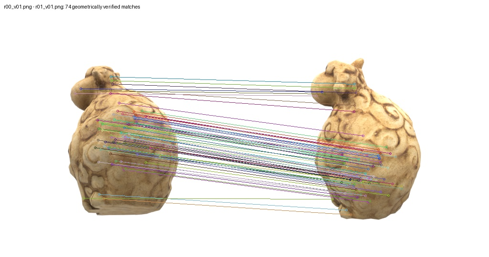
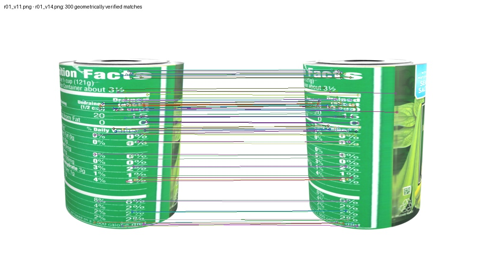
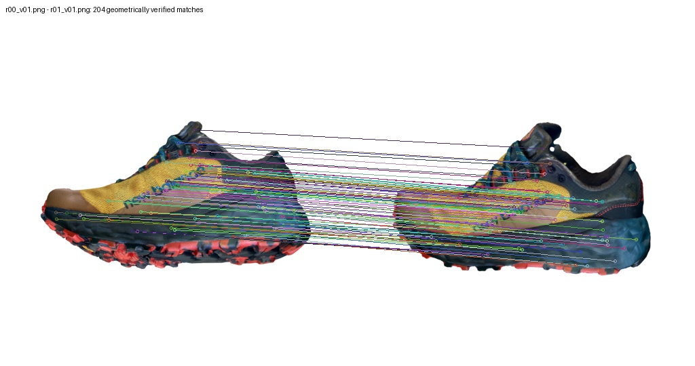
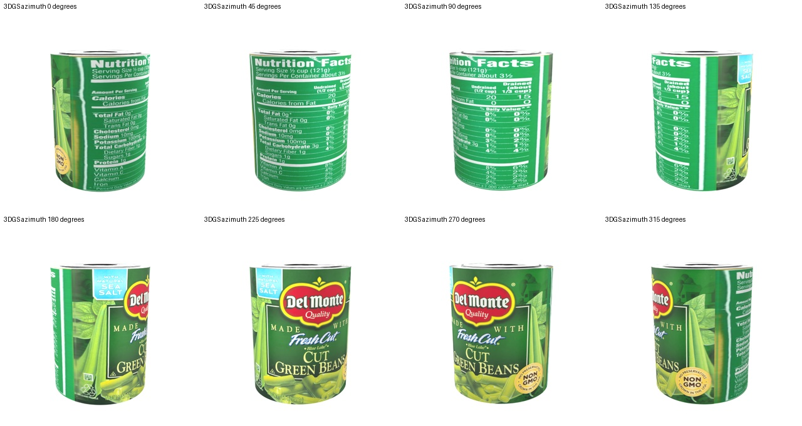
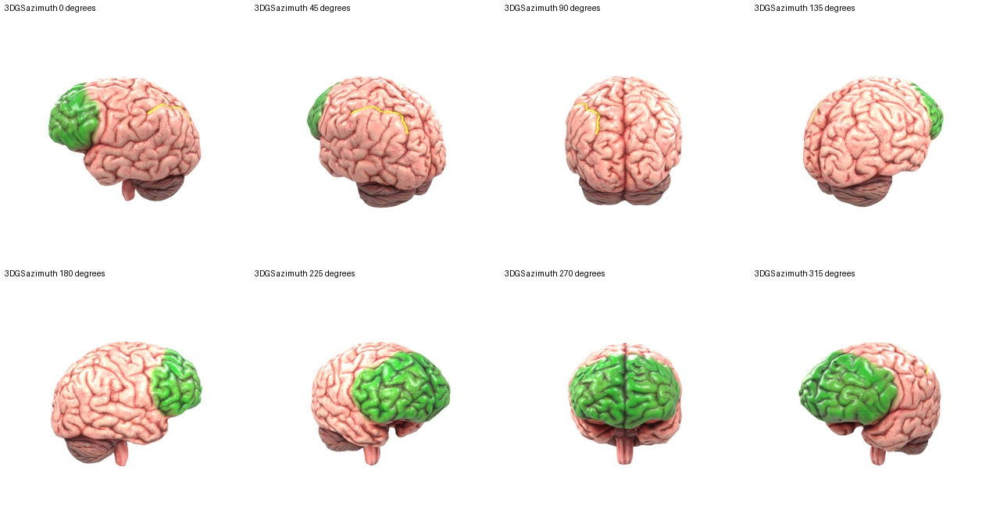
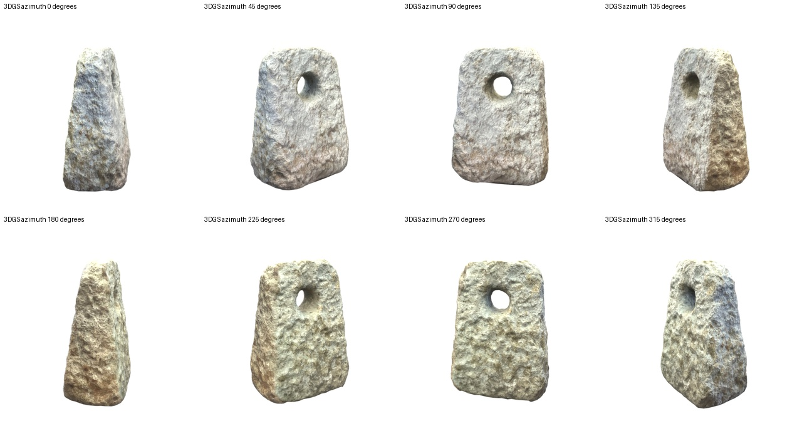
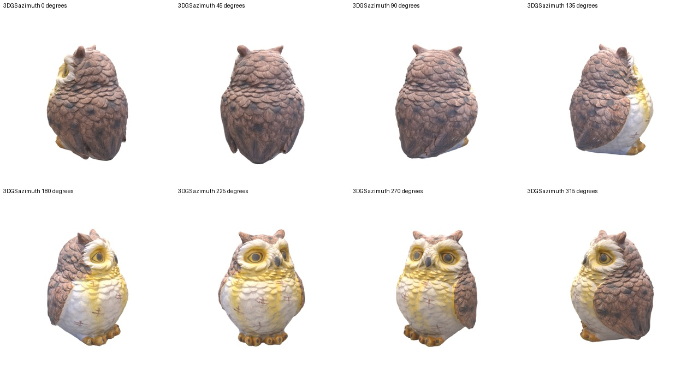
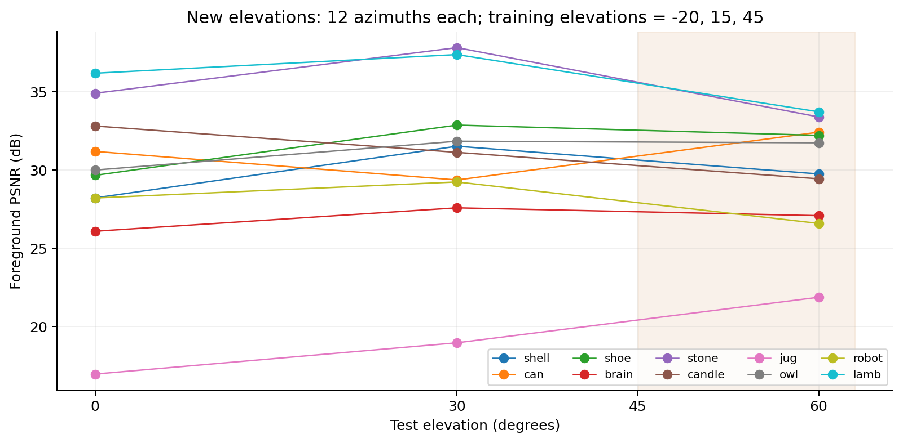

# 作业2：从多视角图像到新视角渲染

组号：第一组  
成员：董天傲、黄瑞翔、陈泓逸、郭文涛  
GitHub：[delta-dta/3D-Reconstruction-and-Rendering](https://github.com/delta-dta/3D-Reconstruction-and-Rendering)

我们对Objaverse模型进行筛选与清洗，再生成多视角图像，通过SIFT/COLMAP恢复相机和稀疏点，训练3D Gaussian Splatting并渲染新视角。下面说明数据、实现、10个物体的结果及对照实验。

## 1. 成员分工

| 成员 | 主模块与交付 | 对照实验及文档职责 |
|---|---|---|
| 董天傲 | 数据来源与清洗结果整理；多视角图像生成、掩码和训练/测试划分 | 24/48/96视角数量实验；数据与成像部分文档 |
| 黄瑞翔 | SIFT特征、匹配、SfM相机恢复；匹配数据导出与几何质量分析 | 真实位姿对照；相机误差与匹配案例分析 |
| 陈泓逸 | 3DGS环境与训练设置；十物体优化、模型保存与损失记录 | 7k/30k训练时长实验；训练曲线及优化部分文档 |
| 郭文涛 | 新视角指标、GIF与展示页面；结果汇总和提交材料组织 | 新高度实验；报告合并、PDF排版与仓库复现说明 |

## 2. 多视角数据集的构建

### 2.1 Objaverse模型筛选

源数据来自Objaverse v1.0的 `000-000`～`000-010`，含两端共11个分片、55,000个GLB。为获得适合多视角匹配和3DGS优化的物体，采用以下筛选规则：

| 筛选项 | 具体规则 |
|---|---|
| 主体完整性 | 保留完整、独立、可识别的静态物体；排除建筑、房间、地形、多物体场景、残缺扫描、散落几何及二维看板；允许属于同一物体的部件和简单底座 |
| 几何与大小 | 无动画及点、线图元；三角面数为500～1,000,000，文件不超过100 MiB，能够正常加载并渲染 |
| 表面特征 | 贴图或顶点颜色覆盖的三角面比例至少为10%；也允许至少两种各覆盖10%三角面、归一化RGB距离不小于0.2的材质颜色；排除缺失、错误贴图和大面积无细节表面 |
| 材质 | 主体以不透明、低反光材质为主；透明材质和强反光材质各自覆盖的三角面比例均不超过50%，视觉筛选进一步排除以玻璃、镜面或强反光金属为主的资产 |
| 可见性与特征数量 | 渲染4张256×256预览；至少3个视角的前景占比达到2%，四视角前景内部SIFT数量的中位数至少为30；提取前使用sigma=0.6平滑，并将前景掩码向内腐蚀3像素，减少噪声和轮廓造成的假特征 |
| 完全重复 | 按GLB文件的SHA-256去重，保留资产UID、源路径与校验值 |

筛选依次结合元数据、GLB几何与材质解析、实际渲染及前景特征统计。四张预览的方位角依次为0°、90°、180°、270°，对应俯仰角为20°、30°、20°、30°；材质比例按覆盖的三角面数统计。对满足数值条件的资产，再由DeepSeek根据四视角拼图检查主体完整性、表面细节与材质。采用配置中的DeepSeek-V4.1-Flash-1017，接口调用名为 `deepseek-flash`，temperature=0，要求返回包含 `keep` 和 `caption` 的JSON，保留 `keep=true` 的资产。

最终从55,000个模型中保留 **7,819个，约占14.22%**。原始GLB保持原位置。从中选取10个具备稳定重建条件的物体，另行生成512×512多视角图像用于后续实验。

### 2.2 多视角图像生成

物体沿用清洗时的归一化，将包围盒中心移至原点、最长边缩放到2。相机沿三个高度的圆周环绕物体，相机距离由包围盒和视场角确定，乘以1.05的边界裕量，使物体完整进入视野。世界坐标采用Blender的Z轴向上。Blender相机的局部坐标为X向右、Y向上、朝−Z观察；转换到OpenCV的X向右、Y向下、Z向前坐标时，使用 `c2w_cv = c2w_blender @ diag(1,−1,−1,1)`，并取逆得到 `w2c_cv`。

| 设置 | 数值或方法 |
|---|---|
| 渲染器 | Blender 4.5.3，Cycles CUDA，GPU OIDN降噪 |
| 图像 | 512×512，64 samples，纹理分辨率上限2048 |
| 光照 | 固定世界与三盏面积光，所有视角保持相同场景 |
| 相机 | 50 mm焦距、36 mm传感器宽度；PINHOLE内参 |
| 训练成像高度 | −20°、15°、45° |
| 方位采样 | 每个高度40张，间隔9°，合计120张/物体 |
| 训练/测试划分 | 每圈每5张留出1张；96张训练、24张测试 |
| 背景与掩码 | RGBA合成白背景；alpha>0.5作为前景；SIFT掩码再腐蚀3像素 |
| 随机种子 | 20261106，各条件固定 |

在该分辨率下，`fx = fy = 512×50/36 ≈ 711.11 px`，主点为 `(256,256)`。每圈编号为0、5、10、…、35的8张图作为测试，其余32张作为训练，三圈合计96/24。RGBA先与白色背景合成为8位RGB，alpha阈值生成前景掩码；训练RGB放在 `data/images/`，测试RGB放在 `data/test_images/`。训练集合用于特征提取、SfM、坐标对齐和3DGS优化，测试集合用于最后的留出评价。

<figure markdown="1">


<figcaption>图1：三个成像高度的部分输入视角。全部图像及其相机信息在本机完整结果中保存，紧凑仓库保留采样总览、划分与相机元数据。</figcaption>
</figure>

## 3. 基于SfM的稀疏重建

整体数据流为：**清洗资产 → 120张参考图 → 96张训练图 → SIFT与几何验证 → SfM → 3DGS → 留出评价和GIF**。24张测试图只进入最后的评价分支。

### 3.1 SIFT特征匹配

使用 PyCOLMAP 3.13.0 在 CPU 上提取前景内的 SIFT 特征，每张图最多 4,096 个特征。描述子采用配置对应的 RootSIFT 归一化，匹配比例阈值为 0.8，启用交叉检查；穷举训练图像对，再进行两视图几何验证，RANSAC 最大误差为 2 px。前景掩码的腐蚀减少轮廓和白背景边缘对匹配的影响。

96张训练图共有 `96×95/2 = 4,560` 个候选图像对。通过几何验证的对应进入后续恢复。正式10物体共导出 **20,210 个非空几何验证图像对、2,264,799 个内点对应**；对应数量按图像对累计，同一三维点的跨视图观测可以出现在多组对应中。

<figure markdown="1">



<figcaption>图2：羊形摆件跨高度的实际几何验证对应。为保证可读性，单张图最多绘制80条线；标题记录全部内点数，NPZ中保存所有内点。</figcaption>
</figure>

食品罐头的印刷标签与跑鞋的鞋面、鞋底提供了不同类型的局部特征。图3、4分别展示同高度下改变方位、同方位下改变高度的实际匹配，均沿用图2的抽样绘图方式。

<figure markdown="1">



<figcaption>图3：食品罐头的不同方位匹配，图像对为r01_v11与r01_v14。两图俯仰角均为15°、方位角相差27°，共有300组几何验证内点。对应主要分布在标签文字、数字及印刷边界上。</figcaption>
</figure>

<figure markdown="1">



<figcaption>图4：彩色跑鞋的跨高度匹配，图像对为r00_v01与r01_v01。两图方位相同，俯仰角从−20°变为15°，共有204组几何验证内点；鞋面图案、色块边界和鞋底细节在两视图中形成对应。</figcaption>
</figure>

### 3.2 相机位姿恢复

所有训练视角共用一组标定的PINHOLE内参。增量SfM先从满足几何约束的初始图像对建立稀疏模型，三角化匹配点；再利用已有三维点与新图关键点的2D–3D对应，通过PnP注册新相机，并继续三角化和束调整。束调整联合优化相机外参与稀疏点，焦距和主点保持固定。由图像对应恢复的外参和三角化点构成3DGS的几何输入。

SfM结果带有全局尺度、旋转和平移自由度。将估计的96个训练相机中心与Blender记录的对应中心配对，拟合Sim(3)：`x_aligned = s R x_sfm + t`，再一致变换所有恢复的点和相机，使其进入参考图像的世界坐标。该变换统一坐标系，保留相机之间的估计误差；24个测试相机按生成时记录的位姿直接用于评价。主实验使用对齐后的SfM外参，真实完整训练外参用于第6.2节的独立位姿对照。

几何质量同时检查注册率、重投影误差、对齐后的旋转误差和相机中心误差。10个正式物体均恢复96/96张相机，平均重投影误差为 **0.317 px**。相机与稀疏点可在各对象的 `sfm/viewer.html` 中交互查看。

### 3.3 匹配结果的存储格式

每个 `results/hw2_物体/sfm/` 提供以下文件：

| 文件 | 内容 |
|---|---|
| `matches/*.jpg` | 4组有代表性的实际匹配可视化 |
| `verified_pairs.csv` | 全部非空验证图像对、pair ID和内点数 |
| `image_ids.json` | 图像ID与文件名的映射 |
| `geometric_matches.npz` | 全部关键点矩阵与每对图像的内点下标 |
| `cameras.json`、`points_aligned.ply`、`viewer.html` | 对齐后的相机、稀疏点及交互视图 |

NPZ中的 `keypoints_<image_id>` 前两列为像素位置；`inliers_<pair_id>` 为N×2的关键点下标。COLMAP的编码为 `pair_id = smaller_id × 2147483647 + larger_id`。匹配图抽样展示连线，NPZ保存全部验证对应；读取示例见[匹配数据说明](MATCHING_FORMAT.md)。

## 4. 基于3DGS的新视角渲染

### 4.1 高斯模型的优化

使用官方3D Gaussian Splatting实现，每个物体独立训练一个模型。初始高斯的中心和颜色取自COLMAP稀疏点，初始尺度由点的邻域距离估计。优化参数包括中心、旋转、三轴尺度、不透明度及球谐颜色。三维高斯的形状由协方差 `Σ = R diag(sx²,sy²,sz²) Rᵀ` 描述，球谐系数表示随观察方向变化的颜色。

渲染时将三维高斯投影成二维椭圆，按深度从前向后累积颜色：`C(p) = Σ_i [c_i(d) α_i(p) Π_{j<i}(1−α_j(p))]`。其中 `α_i(p)` 由该高斯的不透明度和投影高斯在像素p处的权重决定。通过可微光栅化得到预测RGB，与当前训练图比较，反向传播更新高斯参数。

图像重建损失为 **L = 0.8 L1 + 0.2 (1−SSIM)**，采用白色背景。每次迭代使用一个相机，遍历训练集合后重新打乱；30,000步相当于96图集合约312.5轮。实际优化配置如下，完整参数同时保存在各条件的 `model/training_config.json`。

| 参数 | 设置 |
|---|---|
| 优化器 | Adam，eps=1e−15 |
| 位置学习率 | 基础值从1.6e−4指数衰减到1.6e−6，实际值乘以相机分布的空间尺度 |
| 颜色学习率 | 球谐DC项2.5e−3，其余系数1.25e−4 |
| 其他学习率 | 不透明度0.025，尺度0.005，旋转0.001 |
| 球谐阶数 | 从0开始，每1,000步升一阶，最高3阶 |
| 增密 | 500步后、15,000步前，每100步检查投影梯度，阈值2e−4；结合高斯尺度进行复制或分裂 |
| 裁剪与不透明度 | 裁剪不透明度低于0.005的高斯，并按尺寸处理过大的高斯；增密阶段每3,000步重置不透明度，白底条件在第500步也重置 |
| 阶段划分 | 前15,000步进行增密与参数优化，后15,000步固定高斯集合继续优化 |

保存7,000步和30,000步的可渲染高斯PLY，用于阶段比较；本机保留最终恢复状态，支持后续接入继续优化。训练损失每100步记录一次。固定官方代码版本为 `54c035f7834b564019656c3e3fcc3646292f727d`；本地 CUDA 兼容补丁只补充标准头文件，未改变训练算法。

### 4.2 渲染结果的评价

在24个留出视角上，用对应真实相机渲染高斯模型，与参考RGB比较。参考图由8位RGB除以255得到，预测值截断到 `[0,1]`。全图MSE对所有像素及RGB通道取均值，`PSNR = −10 log10(MSE)`；前景PSNR用同一公式，只统计真实alpha>0.5的像素。SSIM使用11×11、sigma=1.5的高斯窗口，再对空间位置和RGB通道平均。每个物体先逐图计算指标，再对24张取均值；总结果对10个物体等权平均。

全图指标反映整体图像一致性，前景PSNR集中评价物体区域。所有指标直接使用浮点渲染输出计算。

每个物体另在15°高度渲染一圈72帧动画，帧间方位差5°、每帧70 ms。GIF由训练后的高斯模型产生。PDF中的静态总览选取其中8个视角；完整动画见“物体结果索引”一节链接及仓库。

### 4.3 运行环境

| 项目 | 配置 |
|---|---|
| GPU与训练 | RTX 5090 32GB；CUDA原生sm_120扩展 |
| Python与框架 | Python3.12.3；PyTorch2.8.0+cu129；torchvision0.23.0+cu129 |
| 成像与SfM | Blender4.5.3；PyCOLMAP3.13.0 CPU |
| 编译 | CUDA12.9、GCC13.3；补丁在 `patches/` |
| 完整流程入口 | `run_pipeline.py` |
| 成像与数据 | `render_hw2.py`、`prepare_hw2.py` |
| 相机恢复 | `reconstruct_hw2.py` |
| 优化与评价 | `train_hw2.py`、`evaluate_hw2.py` |
| 展示与聚合 | `finalize_hw2.py`、`finalize_course.py` |

所有程序位于 `programs/`，物体及实验参数在对应JSON配置中，各条件的实际训练配置、损失和逐视角指标随结果保存。

## 5. 十个物体的重建结果

下表来自 `results/metrics.csv`，所有对象均为96张训练、24张测试、30,000步优化。

| 物体 | 注册图 | 稀疏点 | 重投影px | 前景PSNR | 全图PSNR | SSIM |
|---|---|---|---|---|---|---|
| 贝壳标本 | 96/96 | 10,237 | 0.297 | 32.708 | 39.905 | 0.99271 |
| 食品罐头 | 96/96 | 7,487 | 0.357 | 32.143 | 36.441 | 0.99139 |
| 彩色跑鞋 | 96/96 | 4,746 | 0.369 | 32.187 | 38.016 | 0.99131 |
| 解剖教学模型 | 96/96 | 8,995 | 0.364 | 29.397 | 35.575 | 0.98317 |
| 石质渔具 | 96/96 | 13,103 | 0.243 | 38.047 | 43.505 | 0.99638 |
| 彩绘蜡烛 | 96/96 | 8,562 | 0.336 | 34.476 | 38.909 | 0.99153 |
| 装饰陶壶 | 96/96 | 9,068 | 0.282 | 18.923 | 25.864 | 0.93640 |
| 猫头鹰摆件 | 96/96 | 9,242 | 0.319 | 32.266 | 37.674 | 0.98645 |
| 机器人模型 | 96/96 | 10,610 | 0.285 | 30.866 | 36.292 | 0.98811 |
| 羊形陶质摆件 | 96/96 | 6,977 | 0.320 | 37.944 | 43.811 | 0.99538 |
| **10物体均值** | **960/960合计** | — | **0.317** | **31.896** | **37.599** | **0.98528** |

PSNR单位为dB，SSIM越大越好。下列10张总览均由训练后的高斯渲染产生，每张展示同一物体的8个方位。

<table class="gallery">
<tr><td><b>贝壳标本 / shell</b><br></td><td><b>食品罐头 / can</b><br></td></tr>
<tr><td><b>彩色跑鞋 / shoe</b><br></td><td><b>解剖教学模型 / brain</b><br></td></tr>
<tr><td><b>石质渔具 / stone</b><br></td><td><b>彩绘蜡烛 / candle</b><br></td></tr>
<tr><td><b>装饰陶壶 / jug</b><br></td><td><b>猫头鹰摆件 / owl</b><br></td></tr>
<tr><td><b>机器人模型 / robot</b><br></td><td><b>羊形陶质摆件 / lamb</b><br></td></tr>
</table>

图5：10个物体的多方位重建。GIF入口与精确资产UID见“物体结果索引”一节。

贝壳、石质物体和羊形摆件的表面细节在留出视角中较稳定。陶壶的主体与把手能够连续恢复，误差主要分布于细密环纹、磨损细节和轮廓附近，前景PSNR为18.923 dB。注册率描述相机恢复的完整程度，留出图像与误差图进一步描述纹理和轮廓的重建精度。

<figure markdown="1">


<figcaption>图6：十物体的全图/前景PSNR及平均重投影误差。各物体的24张参考图、预测图和误差图在结果页中逐项列出。</figcaption>
</figure>

## 6. 重建质量的影响因素

本节分别比较输入观测、相机几何和高斯优化。所有条件固定随机种子20261106，每个正式条件执行一次；视角数量和位姿实验在羊形摆件、罐头、机器人三个代表物体上进行，训练时长及新高度实验覆盖全部10个物体。

### 6.1 训练视角数量

选择羊形摆件、罐头和机器人作为代表。以主实验96张训练图为母集，按顺序每4张取1张得到24张、每2张取1张得到48张，形成24⊂48⊂96的嵌套子集。所有条件使用相同24张测试图、512分辨率和30,000步预算。每个子集重新提取特征、匹配、恢复相机并训练，并用该子集的训练相机中心进行坐标对齐。

| 物体 | 24图前景PSNR | 48图前景PSNR | 96图前景PSNR | 24→96变化 |
|---|---|---|---|---|
| 羊形摆件 | 31.201 | 36.110 | 37.944 | +6.743 |
| 食品罐头 | 26.571 | 30.123 | 32.143 | +5.572 |
| 机器人 | 7.239 | 7.745 | 30.866 | +23.627 |
| **配对均值变化** | — | — | — | **+11.981** |

机器人24图条件注册24/24相机，对齐后旋转误差中位数为66.976°；48图条件的旋转误差为17.824°。96图基线将该误差降至约0.079°，恢复出正确的环绕结构。各条件均使用自身SfM结果继续训练，因而表中的7.239/7.745/30.866 dB直接展示了相机几何差异如何传递到新视角渲染。

羊形摆件和罐头分别提升6.743和5.572 dB，机器人提升23.627 dB，三者的配对均值为11.981 dB。增加视角同时补充可见表面、增强匹配约束并改变稀疏初始化；固定30,000步预算，使该对照量化了输入观测增加后的端到端收益。

### 6.2 相机位姿精度

同三个物体使用96张训练图，保留与基线完全相同的 COLMAP 稀疏点，只将训练相机外参替换为渲染器导出的真实外参，再重新优化。`pose_control.json` 记录初始点坐标一致性。

| 物体 | SfM位姿前景PSNR | 真实位姿前景PSNR | 变化dB |
|---|---|---|---|
| 羊形摆件 | 37.944 | 40.040 | +2.096 |
| 食品罐头 | 32.143 | 38.749 | +6.606 |
| 机器人 | 30.866 | 32.614 | +1.748 |
| **配对均值变化** | — | — | **+3.483** |

三个物体在相同图像、稀疏点初始化和训练预算下均得到提升，平均增益为3.483 dB。该对照量化了改善训练外参对纹理与轮廓对齐的作用，也表明在像素重投影误差较小的情况下，相机精度仍能进一步影响最终画质。

### 6.3 优化迭代次数

在全部10物体上加载保存的7,000步和30,000步高斯PLY，用同一测试集评价。

| 物体 | 7k前景PSNR | 30k前景PSNR | 变化dB |
|---|---|---|---|
| shell | 31.110 | 32.708 | +1.598 |
| can | 30.738 | 32.143 | +1.406 |
| shoe | 31.443 | 32.187 | +0.744 |
| brain | 28.229 | 29.397 | +1.168 |
| stone | 35.383 | 38.047 | +2.664 |
| candle | 32.750 | 34.476 | +1.726 |
| jug | 18.876 | 18.923 | +0.047 |
| owl | 31.758 | 32.266 | +0.508 |
| robot | 28.995 | 30.866 | +1.871 |
| lamb | 36.321 | 37.944 | +1.623 |
| **配对均值变化** | — | — | **+1.335** |

7k处于增密和裁剪阶段；15k后固定高斯集合，继续优化至30k。10物体平均提升1.335 dB，其中石质物体提升2.664 dB，陶壶提升0.047 dB。阶段收益的差异说明，优化进程应与物体误差分布共同观察；对于几何已完整且后期收益较小的对象，可以进一步通过位姿、分辨率和局部观测对照定位细节误差。

<figure markdown="1">


<figcaption>图7：三个对照维度的前景PSNR。图像数量和位姿对照使用三个代表物体，训练时长对照覆盖全部10物体。</figcaption>
</figure>

### 6.4 测试视角高度

另在0°、30°、60°三个高度各生成12张新参考图，方位统一偏移4.5°，每物体36张，共360张。它们不进入训练或坐标对齐。0°、30°位于训练高度之间，60°超过最高训练高度45°；其他成像设置保持一致。

| 新高度 | 图像数量 | 平均前景PSNR | 与训练高度的关系 |
|---|---|---|---|
| 0° | 120 | 29.438 | 高度范围内的新视角 |
| 30° | 120 | 30.785 | 高度范围内的新视角 |
| 60° | 120 | 29.835 | 超出训练高度范围 |

<figure markdown="1">



<figcaption>图8：各物体在独立高度上的表现。0°、30°和60°的均值分别为29.438、30.785和29.835 dB，性能随高度呈非单调变化；新增视角改变了可见表面，逐物体曲线展示了训练覆盖与表面可见性共同影响的结果。</figcaption>
</figure>

### 6.5 重复纹理的匹配歧义

正式对象筛查时，编织器物的96张相机全部注册，平均重投影误差约0.397 px，但对齐后的旋转误差中位数约90.208°。结合其周期编织纹理和相机分布，判断局部重复外观产生了歧义对应。这展示了“特征多、注册率高、重投影误差低”仍可能伴随错误全局几何的情况。该案例单独保留，从同一清洗集合选择跑鞋作为正式对象，未计入10物体均值。详细证据见[匹配案例](MATCHING_CASE.md)。

这些实验形成了清晰的优化顺序：先用充分的观测覆盖建立可靠对应和相机几何，再通过增密、裁剪和后期参数优化改善高斯表示。逐视角误差图可以继续用于选择补充拍摄的位置，并将位姿、成像分辨率和训练设置的影响分别量化。

## 7. 仓库组织

仓库地址：[https://github.com/delta-dta/3D-Reconstruction-and-Rendering](https://github.com/delta-dta/3D-Reconstruction-and-Rendering)。

| 位置 | 用途 |
|---|---|
| `docs/HOMEWORK2_REPORT.md`、`.pdf` | 正式报告源文件及同源PDF |
| `programs/` | 清洗、成像、匹配、SfM、训练、评价与整理代码 |
| `configs/` | 对象、控制实验、提示词与环境相关配置 |
| `scripts/` | 固定运行命令；已完成命令以注释保留 |
| `results/hw2_*/` | 10物体GIF、匹配、相机、逐视角对照与指标 |
| `results/ablations/` | 9个额外训练条件的关键结果 |
| [清洗清单](../results/assignment1/cleaned_models.jsonl)、[对象清单](../results/assignment1/hw2_candidates.jsonl) | 保留资产、正式对象选择及来源记录 |
| `docs/PROMPTS.md`、`docs/AI_USAGE.md` | 业务提示词与AI辅助范围 |
| `environment.yml`、`patches/` | 固定依赖和兼容补丁 |
| `index.html` | 完整解压后可离线浏览的总览入口 |


运行入口是 `programs/run_pipeline.py`。先按[PIPELINE说明](PIPELINE.md)准备环境和源GLB，在 `configs/pipeline.json` 中设置数据根目录，然后从仓库根目录执行：

```bash
python -B programs/run_pipeline.py --config configs/hw2_lamb.json
```

该命令依次执行 **render → prepare → reconstruct → train → evaluate → finalize**，SfM阶段同时导出全部验证匹配。其他9物体更换对应JSON配置，批处理命令集中在 `scripts/run_pipeline.sh`。新运行结果保存在 `outputs/pipeline/物体/`，每次记录解析后的参数和阶段日志。已有正式结果在 `results/` 中保留。

主实验与对照共包含10物体基线、9个额外训练条件、20次阶段评价和360张新高度图评价。各条件的JSON/CSV与实际匹配数据保存在仓库中，完整下载后可通过 `index.html` 浏览动画、交互点云和测试误差。

## 物体结果索引

以下链接逐项对应正式10物体。结果页提供相机与点云、匹配图及24个测试视角的对照；全部验证匹配位于各对象的 `sfm/`。资产作者、许可与源地址见[资产署名](ASSET_CREDITS.md)。

| 对象 | Objaverse UID | 动画与结果 |
|---|---|---|
| 贝壳 / shell | `e4d2903fd8c643669c2d3b3ab081e5e7` | [GIF](../results/hw2_shell/reconstruction.gif) · [结果](../results/hw2_shell/index.html) |
| 罐头 / can | `056e0c896ce34f13b92dca2c39de44d0` | [GIF](../results/hw2_can/reconstruction.gif) · [结果](../results/hw2_can/index.html) |
| 跑鞋 / shoe | `40a95876e4164dfc885b6e8f0136dfe3` | [GIF](../results/hw2_shoe/reconstruction.gif) · [结果](../results/hw2_shoe/index.html) |
| 教学模型 / brain | `aa7e9bf472e3482eaa044ffa346fb175` | [GIF](../results/hw2_brain/reconstruction.gif) · [结果](../results/hw2_brain/index.html) |
| 石质物体 / stone | `0d3ccab55b724ca6a5c87881d16b4d58` | [GIF](../results/hw2_stone/reconstruction.gif) · [结果](../results/hw2_stone/index.html) |
| 蜡烛 / candle | `d9f66a5fd13945429f1a1896c1102e9f` | [GIF](../results/hw2_candle/reconstruction.gif) · [结果](../results/hw2_candle/index.html) |
| 陶壶 / jug | `a904a1c301f84bbb8af232dd612d436d` | [GIF](../results/hw2_jug/reconstruction.gif) · [结果](../results/hw2_jug/index.html) |
| 猫头鹰 / owl | `040143111d264848949bee737058b83c` | [GIF](../results/hw2_owl/reconstruction.gif) · [结果](../results/hw2_owl/index.html) |
| 机器人 / robot | `502ba288b5ff45acacf0e8ca85e57774` | [GIF](../results/hw2_robot/reconstruction.gif) · [结果](../results/hw2_robot/index.html) |
| 羊形摆件 / lamb | `97989d443ac048acb6bb42a2f82c6324` | [GIF](../results/hw2_lamb/reconstruction.gif) · [结果](../results/hw2_lamb/index.html) |

HTML结果页在完整解压包中可直接打开；GitHub网页可直接查看GIF、JSON、CSV与Markdown，交互HTML需下载后在浏览器中打开。

## AI辅助使用说明

SIFT匹配、SfM、3DGS训练和评价不调用语言模型。数据筛选阶段的DeepSeek使用四视角拼图，完整实际提示词与请求参数保存在[提示词记录](PROMPTS.md)和 `configs/preview_deepseek.json`，随代码一并提交。

项目使用AI编程助手辅助代码、实验执行与文档整理，记录范围见[AI_USAGE](AI_USAGE.md)。所用资产及第三方代码的来源保留在[资产署名](ASSET_CREDITS.md)和[代码来源](THIRD_PARTY.md)中。
