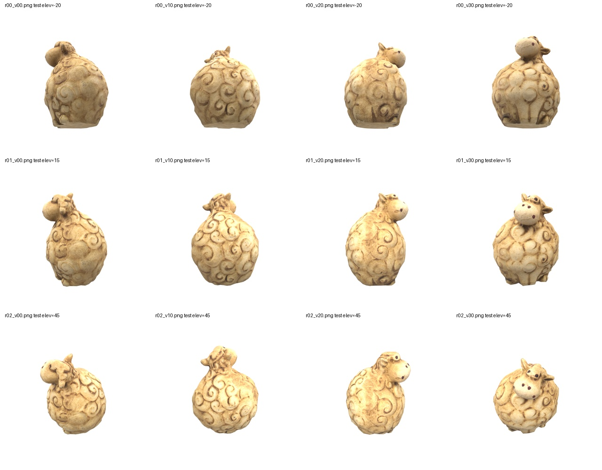
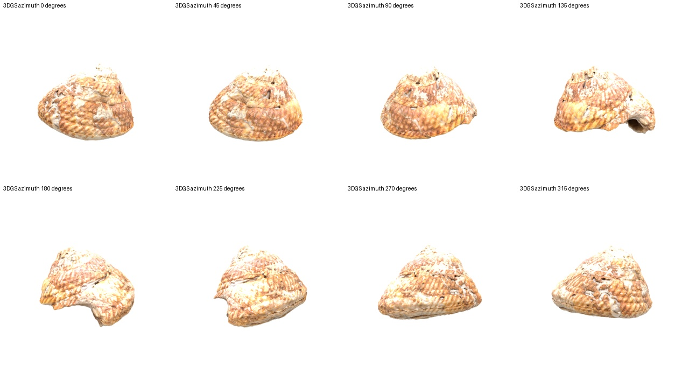
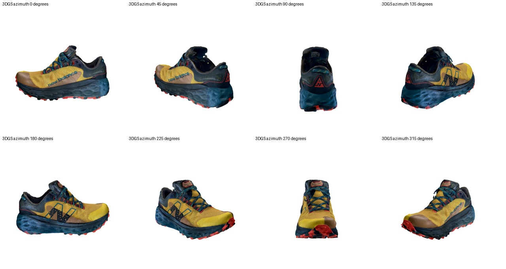
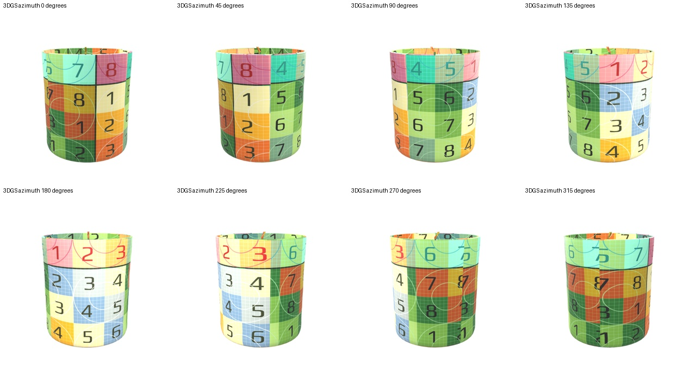
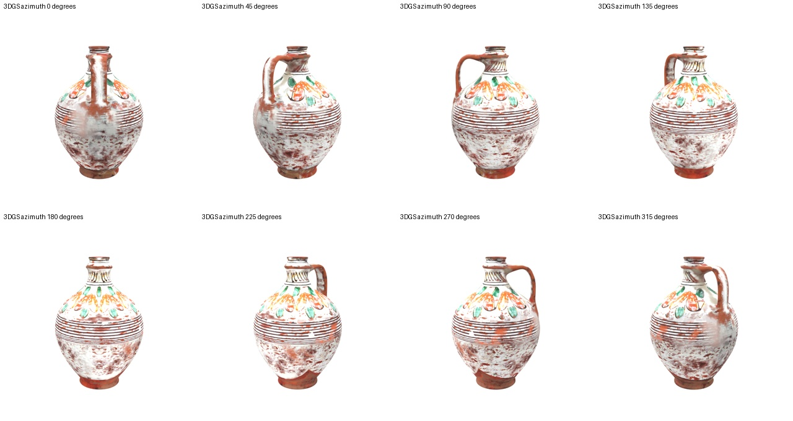
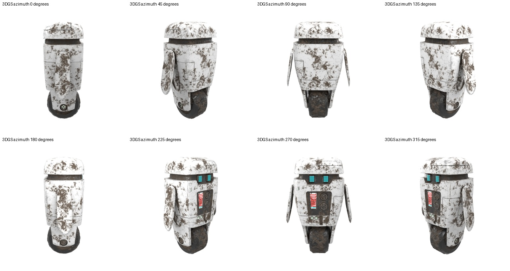
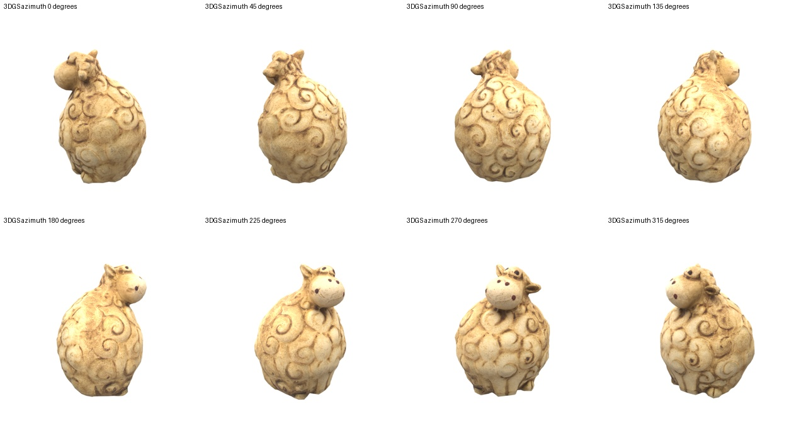
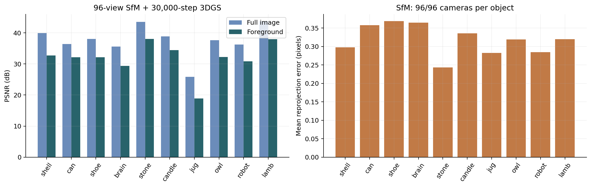
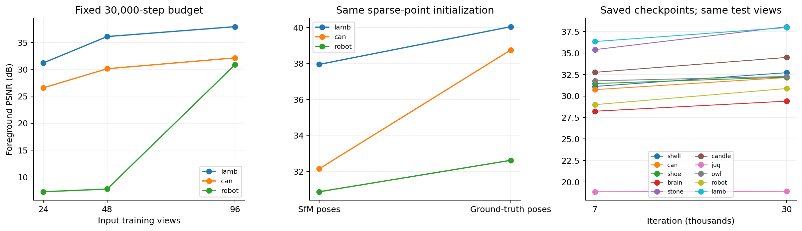

# 作业2：三维重建与渲染

组号：第一组  
成员：成员1、成员2、成员3、成员4  
GitHub：[delta-dta/3D-Reconstruction-and-Rendering](https://github.com/delta-dta/3D-Reconstruction-and-Rendering)

我们使用作业1筛选出的Objaverse模型生成多视角图像，通过SIFT/COLMAP恢复相机和稀疏点，再训练3D Gaussian Splatting并渲染新视角。下面说明数据、实现、10个物体的结果及对照实验。

## 1. 流程与分工

作业要求使用作业1清洗后的数据，完成从图像到三维重建及 NeRF 或 3DGS 渲染的流程，在 10 个不同物体上验证，并分析哪些步骤影响最终效果。本项目选择 **3DGS** 作为重建表示与渲染方法。SfM、匹配和训练结果均由实际执行得到。

四位成员按相近工作量分配，每人预计承担 **25%**。成员名称按要求使用代称；下表是均衡分工安排，提交前由组内核对实际贡献。AI 辅助范围另见“提示词和AI辅助说明”一节。

| 成员 | 主模块与交付 | 对照实验及文档职责 | 预计工作量 |
|---|---|---|---|
| 成员1 | 数据来源与清洗结果整理；多视角图像生成、掩码和训练/测试划分 | 24/48/96视角数量实验；数据与成像部分文档 | 25% |
| 成员2 | SIFT特征、匹配、SfM相机恢复；匹配数据导出与几何质量分析 | 真实位姿对照；相机误差与匹配案例分析 | 25% |
| 成员3 | 3DGS环境与训练设置；十物体优化、模型保存与损失记录 | 7k/30k训练时长实验；训练曲线及优化部分文档 | 25% |
| 成员4 | 新视角指标、GIF与展示页面；结果汇总和提交材料组织 | 新高度实验；报告合并、PDF排版与仓库复现说明 | 25% |

## 2. 数据来源与多视角图像

### 2.1 沿用作业1的清洗结果

源数据来自 Objaverse v1.0 的 `000-000`～`000-010`，含两端共 11 个分片、55,000 个 GLB。筛选以独立、完整、静态物体为目标，要求具有可辨识表面细节，以不透明、低反光材质为主；保留 500～1,000,000 个三角面、文件不超过 100 MiB 的资产。元数据与材质筛选后实际渲染四个预览视角，再结合前景面积、SIFT 和 DeepSeek 视觉判别形成最终清单。

各阶段数量为：**55,000 → 44,597 → 31,614 → 31,607 → 17,150 → 7,819**。这些数量依次对应原始输入、元数据候选、材质候选、成功渲染、进入视觉接口筛选、最终保留。SHA-256 完全重复数为 0。原始 GLB 保持原位置，清单记录 UID、源路径和 SHA-256。详细规则见[作业1报告](ASSIGNMENT1.md)。

四视角清洗预览的分辨率为 256×256；它们用于选资产。作业2另行生成密集的 512×512 多视角图像。正式10物体包括贝壳、罐头、跑鞋、解剖教学模型、石质渔具、蜡烛、陶壶、猫头鹰摆件、机器人和羊形摆件；UID 与结果逐项列于“物体与结果文件”一节。

### 2.2 受控成像与数据划分

物体沿用清洗时的归一化，居中并将最长边缩放到 2。相机距离依据包围盒和视场角计算，留出 1.05 倍边界裕量，避免截断物体。世界坐标采用 Blender 的 Z 轴向上；导出时同时记录 Blender 与 OpenCV 相机坐标约定。

| 设置 | 数值或方法 |
|---|---|
| 渲染器 | Blender 4.5.3，Cycles CUDA，GPU OIDN降噪 |
| 图像 | 512×512，64 samples，纹理分辨率上限2048 |
| 光照 | 固定世界与三盏面积光，所有视角保持相同场景 |
| 相机 | 50 mm焦距、36 mm传感器宽度；PINHOLE内参 |
| 训练成像高度 | −20°、15°、45° |
| 方位采样 | 每个高度40张，间隔9°，合计120张/物体 |
| 训练/测试划分 | 每圈每5张留出1张；96张训练、24张测试 |
| 背景与掩码 | RGBA合成白背景；alpha>0.5作为前景；SIFT掩码再腐蚀3像素 |
| 随机种子 | 20261106，各条件固定 |

在该分辨率下，`fx = fy ≈ 711.11 px`，主点为 `(256, 256)`。`data/images/` 只放训练 RGB，测试 RGB 独立放在 `data/test_images/`。24 张测试图像及其相机外参不进入特征提取、SfM、3DGS 训练或坐标对齐。

<figure markdown="1">



<figcaption>图1：三个成像高度的部分输入视角。全部图像及其相机信息在本机完整结果中保存，紧凑仓库保留采样总览、划分与相机元数据。</figcaption>
</figure>

## 3. 图像到相机与稀疏结构

整体数据流为：**清洗资产 → 120张参考图 → 96张训练图 → SIFT与几何验证 → SfM → 3DGS → 留出评价和GIF**。24张测试图只进入最后的评价分支。

### 3.1 特征提取与几何验证

使用 PyCOLMAP 3.13.0 在 CPU 上提取前景内的 SIFT 特征，每张图最多 4,096 个特征。描述子采用配置对应的 RootSIFT 归一化，匹配比例阈值为 0.8，启用交叉检查；穷举训练图像对，再进行两视图几何验证，RANSAC 最大误差为 2 px。前景掩码的腐蚀减少轮廓和白背景边缘对匹配的影响。

96张训练图共有4,560个候选图像对。只有通过几何验证的对应进入后续恢复。正式10物体共导出 **20,210 个非空几何验证图像对、2,264,799 个内点对应**；这些是逐图像对的对应数量之和，并非去重后的三维点数量。

<figure markdown="1">


<figcaption>图2：羊形摆件跨高度的实际几何验证对应。为保证可读性，单张图最多绘制80条线；标题记录全部内点数，NPZ中保存所有内点。</figcaption>
</figure>

### 3.2 增量式 SfM 与坐标对齐

使用固定标定的 PINHOLE 内参，增量恢复训练相机外参、三角化稀疏点，并通过束调整优化重投影误差。真实外参没有用于 SfM 初始化；初始三维点来自图像匹配和三角化，没有从 GLB 表面采样点直接初始化训练。

SfM 结果带有全局尺度、旋转和平移自由度。为在合成参考坐标系中评价，仅使用 **96个训练相机中心** 拟合 Sim(3)，即 `x_aligned = s R x_sfm + t`，并一致变换恢复的点和相机。测试相机不参与拟合。这里的真实训练相机中心用于消除全局坐标自由度；完整真实外参只在专门的位姿对照条件中替代 SfM 外参。

几何质量同时检查注册率、重投影误差、对齐后的旋转误差和相机中心误差。10个正式物体均恢复96/96张相机，平均重投影误差为 **0.317 px**。相机与稀疏点可在各对象的 `sfm/viewer.html` 中交互查看。

### 3.3 匹配结果的提交格式

每个 `results/hw2_物体/sfm/` 提供以下文件：

| 文件 | 内容 |
|---|---|
| `matches/*.jpg` | 4组有代表性的实际匹配可视化 |
| `verified_pairs.csv` | 全部非空验证图像对、pair ID和内点数 |
| `image_ids.json` | 图像ID与文件名的映射 |
| `geometric_matches.npz` | 全部关键点矩阵与每对图像的内点下标 |
| `cameras.json`、`points_aligned.ply`、`viewer.html` | 对齐后的相机、稀疏点及交互视图 |

NPZ中的 `keypoints_<image_id>` 前两列为像素位置；`inliers_<pair_id>` 为 N×2 的关键点下标。COLMAP 的编码为 `pair_id = smaller_id × 2147483647 + larger_id`。读取示例见[匹配数据说明](MATCHING_FORMAT.md)。全部10物体均提供完整验证对应，而不只提交绘图抽样。

## 4. 3DGS优化、渲染与评价

### 4.1 表示和优化

使用官方 3D Gaussian Splatting 实现，每个物体独立训练一个模型。高斯中心初始化自 COLMAP 稀疏点，颜色来自点颜色。优化参数包括中心、旋转、三轴尺度、不透明度及三阶球谐颜色。三维高斯的形状由协方差描述，可写为 `Σ = R diag(sx², sy², sz²) Rᵀ`；各向异性高斯投影到图像后，按可见性和透明度合成颜色。

图像重建损失为 **L = 0.8 L1 + 0.2 (1 − SSIM)**。其余优化超参数沿用固定版本官方实现，并在各条件的 `model/training_config.json` 中完整保存。白色背景，不使用深度监督；球谐最高阶数为3，增密持续到15,000步，总计优化30,000步。每次迭代采样一张训练图，96图条件下30,000步约对应每张图312次访问。

保存7,000步和30,000步的可渲染高斯PLY，用于阶段比较；本机保留最终恢复状态，支持后续接入继续优化。训练损失每100步记录一次。固定官方代码版本为 `54c035f7834b564019656c3e3fcc3646292f727d`；本地 CUDA 兼容补丁只补充标准头文件，未改变训练算法。

### 4.2 留出评价和GIF

在24个留出视角上，用对应真实相机渲染高斯模型，与参考RGB比较。全图PSNR按 `[0,1]` RGB 的均方误差计算，`PSNR = −10 log10(MSE)`；另报告SSIM，以及仅在真实alpha前景中计算的前景PSNR。先对每张图计算指标，再对24张取均值；10物体平均对各物体等权。

白色背景面积会影响全图指标，因此本报告同时报告前景PSNR。指标直接使用浮点渲染输出计算，未使用GIF量化后的图像。

每个物体另在15°高度渲染一圈72帧动画，帧间方位差5°、每帧70 ms。GIF由训练后的高斯模型产生。PDF中的静态总览选取其中8个视角；完整动画见“物体与结果文件”一节链接及仓库。

### 4.3 环境与实现入口

| 项目 | 配置 |
|---|---|
| GPU与训练 | RTX 5090 32GB；CUDA原生sm_120扩展 |
| Python与框架 | Python3.12.3；PyTorch2.8.0+cu129；torchvision0.23.0+cu129 |
| 成像与SfM | Blender4.5.3；PyCOLMAP3.13.0 CPU |
| 编译 | CUDA12.9、GCC13.3；补丁在 `patches/` |
| 完整流程入口 | `run_pipeline.py` |
| 成像与数据 | `render_hw2.py`、`prepare_hw2.py` |
| 相机恢复 | `reconstruct_hw2.py` |
| 优化与评价 | `train_hw2.py`、`evaluate_hw2.py` |
| 展示与聚合 | `finalize_hw2.py`、`finalize_course.py` |

所有程序位于 `programs/`，具体参数在对应JSON配置中。主实验与独立对照部分并行运行，训练耗时包含加载和保存，因此保存的墙钟时间用于记录本次执行，不作为独占GPU的算法速度比较。

## 5. 十个物体的主实验结果

下表来自 `results/metrics.csv`，所有对象均为96张训练、24张测试、30,000步优化。

| 物体 | 注册图 | 稀疏点 | 重投影px | 前景PSNR | 全图PSNR | SSIM |
|---|---|---|---|---|---|---|
| 贝壳标本 | 96/96 | 10,237 | 0.297 | 32.708 | 39.905 | 0.99271 |
| 食品罐头 | 96/96 | 7,487 | 0.357 | 32.143 | 36.441 | 0.99139 |
| 彩色跑鞋 | 96/96 | 4,746 | 0.369 | 32.187 | 38.016 | 0.99131 |
| 解剖教学模型 | 96/96 | 8,995 | 0.364 | 29.397 | 35.575 | 0.98317 |
| 石质渔具 | 96/96 | 13,103 | 0.243 | 38.047 | 43.505 | 0.99638 |
| 彩绘蜡烛 | 96/96 | 8,562 | 0.336 | 34.476 | 38.909 | 0.99153 |
| 装饰陶壶 | 96/96 | 9,068 | 0.282 | 18.923 | 25.864 | 0.93640 |
| 猫头鹰摆件 | 96/96 | 9,242 | 0.319 | 32.266 | 37.674 | 0.98645 |
| 机器人模型 | 96/96 | 10,610 | 0.285 | 30.866 | 36.292 | 0.98811 |
| 羊形陶质摆件 | 96/96 | 6,977 | 0.320 | 37.944 | 43.811 | 0.99538 |
| **10物体均值** | **960/960合计** | — | **0.317** | **31.896** | **37.599** | **0.98528** |

PSNR单位为dB，SSIM越大越好。下列10张总览均由训练后的高斯渲染产生，每张展示同一物体的8个方位。

<table class="gallery">
<tr><td><b>贝壳标本 / shell</b><br></td><td><b>食品罐头 / can</b><br></td></tr>
<tr><td><b>彩色跑鞋 / shoe</b><br></td><td><b>解剖教学模型 / brain</b><br></td></tr>
<tr><td><b>石质渔具 / stone</b><br></td><td><b>彩绘蜡烛 / candle</b><br></td></tr>
<tr><td><b>装饰陶壶 / jug</b><br></td><td><b>猫头鹰摆件 / owl</b><br></td></tr>
<tr><td><b>机器人模型 / robot</b><br></td><td><b>羊形陶质摆件 / lamb</b><br></td></tr>
</table>

图3：10个物体的多方位重建。GIF入口与精确资产UID见“物体与结果文件”一节。

贝壳、石质物体和羊形摆件的表面细节在留出视角中较稳定。陶壶的主体与把手能够连续恢复，但细密环纹、磨损细节和轮廓附近的误差较突出，前景PSNR为18.923 dB。它说明几何完整与纹理精度应分别观察，不能用“相机全部注册”替代新视角评价。

<figure markdown="1">



<figcaption>图4：十物体的全图/前景PSNR及平均重投影误差。各物体的24张参考图、预测图和误差图在结果页中逐项列出。</figcaption>
</figure>

## 6. 哪些环节影响最终重建？

本节用控制条件区分输入观测、相机几何和高斯优化的影响。所有条件固定随机种子，每个正式条件执行一次；结论对应当前合成图像、采样方式和物体集合。

### 6.1 视角数量：覆盖和对应约束共同变化

选择羊形摆件、罐头和机器人作为代表。以主实验96张训练图为母集，按顺序每4张取1张得到24张、每2张取1张得到48张，形成24⊂48⊂96的嵌套子集。所有条件使用相同24张测试图、512分辨率和30,000步预算。每个子集重新提取特征、匹配、恢复相机并训练。

| 物体 | 24图前景PSNR | 48图前景PSNR | 96图前景PSNR | 24→96变化 |
|---|---|---|---|---|
| 羊形摆件 | 31.201 | 36.110 | 37.944 | +6.743 |
| 食品罐头 | 26.571 | 30.123 | 32.143 | +5.572 |
| 机器人 | 7.239 | 7.745 | 30.866 | +23.627 |
| **配对均值变化** | — | — | — | **+11.981** |

机器人24图条件最终注册24/24相机，但对齐后旋转误差中位数为66.976°；48图全部注册，旋转误差仍为17.824°。96图基线的旋转误差中位数约0.079°，恢复出正确的环绕结构。少视图条件没有用真实外参修补，而是保留实际SfM结果继续训练，评价几何错误沿流程传播的影响。

三个对象的均值包含机器人少视图几何退化，因此同时报告逐对象数值。改变视角数会同时改变观测覆盖、匹配约束、稀疏初始化和单张图被采样的次数；这里测量的是固定迭代预算下整条流程的变化。

### 6.2 相机位姿：保持初始稀疏点相同

同三个物体使用96张训练图，保留与基线完全相同的 COLMAP 稀疏点，只将训练相机外参替换为渲染器导出的真实外参，再重新优化。`pose_control.json` 记录初始点坐标一致性。

| 物体 | SfM位姿前景PSNR | 真实位姿前景PSNR | 变化dB |
|---|---|---|---|
| 羊形摆件 | 37.944 | 40.040 | +2.096 |
| 食品罐头 | 32.143 | 38.749 | +6.606 |
| 机器人 | 30.866 | 32.614 | +1.748 |
| **配对均值变化** | — | — | **+3.483** |

较低的像素重投影误差仍可能对应可见的纹理对齐差异。位姿对照中的提升支持“相机精度影响新视角质量”的判断。该条件仍保留 COLMAP 点云和有限步数优化，因此代表受控位姿实验，不将其视为完整几何真值的性能上界。

### 6.3 优化时长：7k与30k

在全部10物体上加载保存的7,000步和30,000步高斯PLY，用同一测试集评价。

| 物体 | 7k前景PSNR | 30k前景PSNR | 变化dB |
|---|---|---|---|
| shell | 31.110 | 32.708 | +1.598 |
| can | 30.738 | 32.143 | +1.406 |
| shoe | 31.443 | 32.187 | +0.744 |
| brain | 28.229 | 29.397 | +1.168 |
| stone | 35.383 | 38.047 | +2.664 |
| candle | 32.750 | 34.476 | +1.726 |
| jug | 18.876 | 18.923 | +0.047 |
| owl | 31.758 | 32.266 | +0.508 |
| robot | 28.995 | 30.866 | +1.871 |
| lamb | 36.321 | 37.944 | +1.623 |
| **配对均值变化** | — | — | **+1.335** |

7k仍在增密阶段，30k已完成增密和后续优化，因此该实验同时反映优化时长与表示容量的变化。不同物体的收益不同：石质物体提升2.664 dB，陶壶提升0.047 dB。对后者而言，仅增加迭代没有明显改善当前细节误差，更适合进一步控制相机精度、成像分辨率和局部观测进行实验。

<figure markdown="1">



<figcaption>图5：三个对照维度的前景PSNR。图像数量和位姿对照使用三个代表物体，训练时长对照覆盖全部10物体。</figcaption>
</figure>

### 6.4 新高度：区分原测试与独立视角变化

另在0°、30°、60°三个高度各生成12张新参考图，方位统一偏移4.5°，每物体36张，共360张。它们不进入训练或坐标对齐。0°、30°位于训练高度之间，60°超过最高训练高度45°；其他成像设置保持一致。

| 新高度 | 图像数量 | 平均前景PSNR | 与训练高度的关系 |
|---|---|---|---|
| 0° | 120 | 29.438 | 高度范围内的新视角 |
| 30° | 120 | 30.785 | 高度范围内的新视角 |
| 60° | 120 | 29.835 | 超出训练高度范围 |

<figure markdown="1">


<figcaption>图6：各物体在独立高度上的表现。高度变化也改变可见表面，因此误差并不随高度单调增大；例如60°均值高于0°，不能据此概括为所有外推视角都更差。独立测试与原24张留出测试分别报告。</figcaption>
</figure>

### 6.5 匹配歧义案例与综合发现

正式对象筛查时，编织器物的96张相机全部注册，平均重投影误差约0.397 px，但对齐后的旋转误差中位数约90.208°。结合其周期编织纹理和相机分布，判断局部重复外观产生了歧义对应。这展示了“特征多、注册率高、重投影误差低”仍可能伴随错误全局几何的情况。该案例单独保留，从同一清洗集合选择跑鞋作为正式对象，未计入10物体均值。详细证据见[匹配案例](MATCHING_CASE.md)。

实验支持以下流程判断：输入覆盖决定可用观测与匹配约束；对应关系和相机几何决定后续优化能否在正确坐标下对齐；3DGS迭代能够继续改善已有表示，但应结合留出指标判断收益。进一步优化优先围绕误差集中区域补充观测，再比较位姿和成像设置，比直接把独立训练扩展到全部7,819个物体更能定位问题。

## 7. 仓库组织、复现与交付

仓库地址：[https://github.com/delta-dta/3D-Reconstruction-and-Rendering](https://github.com/delta-dta/3D-Reconstruction-and-Rendering)。

| 位置 | 用途 |
|---|---|
| `docs/HOMEWORK2_REPORT.md`、`.pdf` | 正式报告源文件及同源PDF |
| `programs/` | 清洗、成像、匹配、SfM、训练、评价与整理代码 |
| `configs/` | 对象、控制实验、提示词与环境相关配置 |
| `scripts/` | 固定运行命令；已完成命令以注释保留 |
| `results/hw2_*/` | 10物体GIF、匹配、相机、逐视角对照与指标 |
| `results/ablations/` | 9个额外训练条件的关键结果 |
| `results/assignment1/` | 清洗清单、正式对象选择及来源记录 |
| `docs/PROMPTS.md`、`docs/AI_USAGE.md` | 业务提示词与AI辅助范围 |
| `environment.yml`、`patches/` | 固定依赖和兼容补丁 |
| `index.html` | 完整解压后可离线浏览的总览入口 |

本机的 `outputs/` 保存完整图像、数据库、高斯PLY、最终检查点和日志；`cleaned/` 保存清洗预览。提交仓库采用紧凑结果，保留作业要求的全部验证对应和10个GIF，运行工具、源GLB、API Key及大型恢复状态不进入Git。固定源代码版本、启动命令与数据路径在[复现说明](REPRODUCE.md)中列出。

运行入口是 `programs/run_pipeline.py`。先按[PIPELINE说明](PIPELINE.md)准备环境和源GLB，在 `configs/pipeline.json` 中设置数据根目录，然后从仓库根目录执行：

```bash
python -B programs/run_pipeline.py --config configs/hw2_lamb.json
```

该命令依次执行 **render → prepare → reconstruct → train → evaluate → finalize**，SfM阶段同时导出全部验证匹配。其他9物体更换对应JSON配置，批处理命令集中在 `scripts/run_pipeline.sh`。新运行结果保存在 `outputs/pipeline/物体/`，每次记录解析后的参数和阶段日志。已有正式结果在 `results/` 中保留。

重新排版本报告使用：

```bash
conda activate 3dvision
python -B programs/prepare_submission.py
python -B programs/export_hw2_report.py
```

PDF导出额外依赖见 `configs/report_requirements.txt`，需系统Pango和Noto CJK字体。页面中引用的图像在导出时嵌入PDF；PDF里的文件链接指向对应GitHub路径。离线浏览HTML时需完整解压提交包，保持 `index.html`、`results/`、`docs/` 的相对位置。

本项目已完成10物体主实验、9个额外训练条件、20次阶段评价和360张新高度图评价。所有指标可追溯到JSON/CSV，匹配数组、数据划分和页面资源经过校验。作业网站提交本PDF及GitHub仓库链接；Markdown和完整展示材料随仓库提供。

## 物体与结果文件

以下链接逐项对应正式10物体。结果页提供相机与点云、匹配图及24个测试视角的对照；全部验证匹配位于各对象的 `sfm/`。资产作者、许可与源地址见[资产署名](ASSET_CREDITS.md)。

| 对象 | Objaverse UID | 动画与结果 |
|---|---|---|
| 贝壳 / shell | `e4d2903fd8c643669c2d3b3ab081e5e7` | [GIF](../results/hw2_shell/reconstruction.gif) · [结果](../results/hw2_shell/index.html) |
| 罐头 / can | `056e0c896ce34f13b92dca2c39de44d0` | [GIF](../results/hw2_can/reconstruction.gif) · [结果](../results/hw2_can/index.html) |
| 跑鞋 / shoe | `40a95876e4164dfc885b6e8f0136dfe3` | [GIF](../results/hw2_shoe/reconstruction.gif) · [结果](../results/hw2_shoe/index.html) |
| 教学模型 / brain | `aa7e9bf472e3482eaa044ffa346fb175` | [GIF](../results/hw2_brain/reconstruction.gif) · [结果](../results/hw2_brain/index.html) |
| 石质物体 / stone | `0d3ccab55b724ca6a5c87881d16b4d58` | [GIF](../results/hw2_stone/reconstruction.gif) · [结果](../results/hw2_stone/index.html) |
| 蜡烛 / candle | `d9f66a5fd13945429f1a1896c1102e9f` | [GIF](../results/hw2_candle/reconstruction.gif) · [结果](../results/hw2_candle/index.html) |
| 陶壶 / jug | `a904a1c301f84bbb8af232dd612d436d` | [GIF](../results/hw2_jug/reconstruction.gif) · [结果](../results/hw2_jug/index.html) |
| 猫头鹰 / owl | `040143111d264848949bee737058b83c` | [GIF](../results/hw2_owl/reconstruction.gif) · [结果](../results/hw2_owl/index.html) |
| 机器人 / robot | `502ba288b5ff45acacf0e8ca85e57774` | [GIF](../results/hw2_robot/reconstruction.gif) · [结果](../results/hw2_robot/index.html) |
| 羊形摆件 / lamb | `97989d443ac048acb6bb42a2f82c6324` | [GIF](../results/hw2_lamb/reconstruction.gif) · [结果](../results/hw2_lamb/index.html) |

HTML结果页在完整解压包中可直接打开；GitHub网页可直接查看GIF、JSON、CSV与Markdown，交互HTML需下载后在浏览器中打开。

## 提示词和AI辅助说明

作业2的SIFT匹配、SfM、3DGS训练和评价不调用语言模型。作业1的DeepSeek筛选使用四视角拼图，完整实际提示词与请求参数保存在[提示词记录](PROMPTS.md)和 `configs/preview_deepseek.json`，随代码一并提交。

项目使用AI编程助手辅助代码、实验执行与文档整理，记录范围见[AI_USAGE](AI_USAGE.md)。成员表为按相近工作量拟定的分工安排，由小组核对实际贡献。所用资产及第三方代码的来源保留在[资产署名](ASSET_CREDITS.md)和[代码来源](THIRD_PARTY.md)中。
