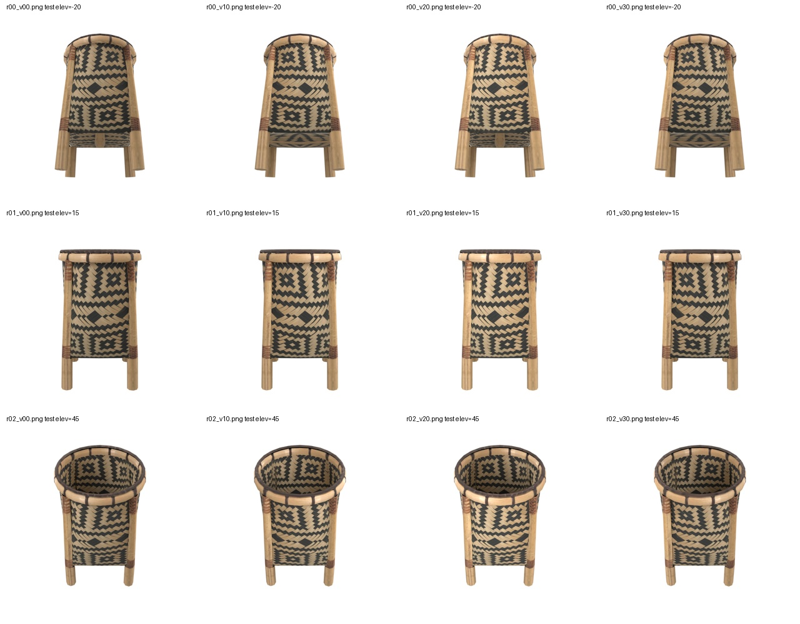

# 匹配案例：特征很多，为什么相机仍然恢复错误？

在正式对象验证中，编织器物 `5bda8ef98bfb4a908bd671b248ee22ba` 的 96 张图全部完成注册，平均重投影误差也不高。但与合成参考位姿对照后，发现全局相机结构明显错误。

| 候选 | 每图 SIFT 中位数 | 注册图 | 重投影误差 px | 旋转误差中位数 | 中心 RMSE |
|---|---|---|---|---|---|
| 编织器物 | 1475.0 | 96/96 | 0.397 | 90.208° | 3.8994 |
| 彩色跑鞋 | 596.5 | 96/96 | 0.369 | 0.126° | 0.0090 |

中心 RMSE 的单位为物体最长边=2；旋转误差是在仅用训练相机中心做 Sim(3) 对齐后计算。

该物体的编织细节有很强的周期重复。结合多视角外观、4,459 个被验证图像对及位姿结果，我们判断局部相似纹理产生了大量歧义对应。SfM 能在这些对应上得到较低的重投影误差，却没有恢复正确的环绕相机结构。

这说明 SIFT 数量、注册率和重投影误差分别衡量不同事情：局部特征可以很多，错误的重复点对应也可能形成内部自洽的几何。相机与参考位姿对照、连续环绕的视觉结果提供了额外证据。

为满足 10 个正式对象均具有稳定重建条件的要求，本项目中止该候选的高斯训练，从已有清洗清单选择彩色跑鞋。跑鞋的文字、非周期色块、鞋带和磨损提供了更明确的对应，正式的 10 物体清单由 `configs/hw2_course.json` 与 `cleaned/hw2_candidates.jsonl` 统一记录。全量 7,819 个清洗结果不变。

该案例保存输入、真实匹配图与估计相机，单独作为流程分析，未混入正式 10 物体均值。可[交互查看相机和点云](../results/matching_case/sfm/viewer.html)，也可查看[原始 SfM 统计](../results/matching_case/sfm/summary.json)。

继续优化这一类对象时，可以研究使用拍摄顺序约束匹配图、提高对应的区分度，以及检查不同视图之间的几何一致性。这里的正式结果继续采用相同的 SIFT/COLMAP 基线完成。
